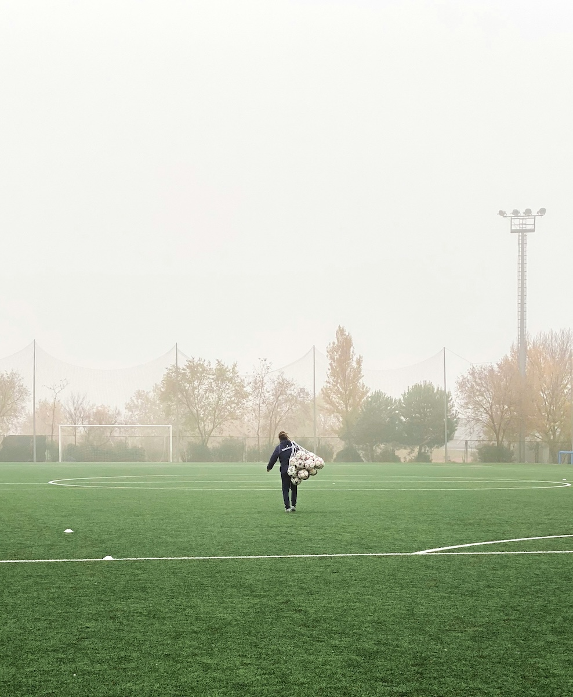

```{r setup, include=FALSE}
usethis::use_git_ignore(c("*.csv", "*.rds"))
options(htmltools.dir.version = FALSE)

library(knitr)
library(tidyverse)
library(xaringan)
library(fontawesome)
```


class: inverse, center, middle

# `r fa("fas fa-images", fill = "#fff")`

**View the slides:** 

[bretsw.com/ade5083-fs26-module5](https://bretsw.com/ade5083-fs26-module5)


---

class: inverse, center, middle

# `r fa("fas fa-handshake-angle", fill = "#fff")` <br><br> Welcome to Module 5:<br>Performance Management


---

class: inverse, center, middle

# `r fa("fas fa-handshake-angle", fill = "#fff")` <br><br>Ch. 10 (Werner, 2022)<br>Coaching and Performance Management

---

# `r fa("fas fa-handshake-angle", fill = "#fff")` Ch. 10: Perf. Management

.pull-left-70[

### Performance Management

```{r, out.width = "100%", echo = FALSE, fig.align = "center"}

```

(Werner, 2022, Figure 10.1, p. 322)

]

--

.pull-right-30[

**Ongoing process of performance improvement:**

1. Define performance
2. Evaluate performance
3. Review performance
4. Provide performance consequences

]


---

# `r fa("fas fa-handshake-angle", fill = "#fff")` Ch. 10: Coaching

.pull-left-70[

### Management as Leadership

```{r, out.width = "100%", echo = FALSE, fig.align = "center"}

```

]

.pull-right-30[

Positive view and active approach to leadership:

**Managers as coaches, not controllers**

]


---

# `r fa("fas fa-handshake-angle", fill = "#fff")` Ch. 10: Coach the Gap

.pull-left-70[

```{r, out.width = "100%", echo = FALSE, fig.align = "center"}

```

]

.pull-right-30[

**Gap = Distance between where you are and where you want to be:**

- Poor performance
- Adaptation to a changing world
- Innovation for a changing need

]


---

# `r fa("fas fa-handshake-angle", fill = "#fff")` Ch. 10: Coaching Processes

.pull-left[

```{r, out.width = "100%", echo = FALSE, fig.align = "center"}

```

(Werner, 2022, Figure 10.2, p. 337)

]

.pull-right[

### Context-Driven Processes

- Know your organizational context
- Rational/Logical approach (Fournies)
- Affective/Emotional approach (Kinlaw)

]


---

class: inverse, center, middle
# `r fa("fas fa-heart-pulse", fill = "#fff")` <br><br>Ch. 11 (Werner, 2022)<br>Employee Counseling, Well-Being, and Wellness

---

# `r fa("fas fa-heart-pulse", fill = "#fff")` Ch. 11: Personal Context

.pull-left-70[

### Factors Outside Work

```{r, out.width = "100%", echo = FALSE, fig.align = "center"}

```

(Add to Werner, 2022, Figure 10.2, p. 337)

]

.pull-right-30[

**Take into account employees' personal stories**

- Don't make assumptions
- Focus on what is relevant to work performance

]


---

# `r fa("fas fa-heart-pulse", fill = "#fff")` Ch. 11: Programs

.pull-left-70[

### Types of Needs and Programs

```{r, out.width = "100%", echo = FALSE, fig.align = "center"}

```
]

.pull-right-30[

**Options:**

- Support programs for mental health and addictions
- Interventions for stress and work-related challenges
- Health and wellness-promotion programs

]


---

# `r fa("fas fa-heart-pulse", fill = "#fff")` Ch. 11: Responsibility

.pull-left[

### Whose job is it?

```{r, out.width = "100%", echo = FALSE, fig.align = "center"}

```

]

.pull-right[

**Focus on what is relevant to work performance!**

- Don't ignore personal context when it affects work performance
- Be aware of mandatory reporting
- Be a network builder: ask for advice and give referrals (this is not a place to star solo performer)

]


---

class: inverse, center, middle

# `r fa("fas fa-binoculars", fill = "#fff")` <br><br> Looking Ahead

---

# `r fa("fas fa-calendar-day", fill = "#fff")` Semester Schedule

```{r, out.width = "360px", echo = FALSE, fig.align = "center"}
include_graphics("img/across-time.jpg")
```

- **Module 1:** Foundations of HRD

- **Module 2:** Assessing Learning Needs & Designing HRD Programs

- **Module 3:** Implementing and Evaluating HRD Programs

- **Module 4:** Onboarding & Training

- **Module 5: Performance Management**

- **Module 6:** Career Development

- **Module 7:** Organizational Development


---

# `r fa("fas fa-calendar-day", fill = "#fff")` Module Structure

```{r, out.width = "480px", echo = FALSE, fig.align = "center"}

```

- `r fa("video", fill = "#782F40")` Zoom Office Hours: **Tuesdays 4:30-5:00pm ET**

- `r fa("fas fa-book-open", fill = "#782F40")` Read

- `r fa("far fa-comments", fill = "#782F40")` Discuss

- `r fa("fas fa-keyboard", fill = "#782F40")` Create (Assignments)


---

# `r fa("fas fa-calendar-day", fill = "#fff")` Assignments

```{r, out.width = "300px", echo = FALSE, fig.align = "center"}
include_graphics("img/build.jpg")
```

###`r fa("fas fa-keyboard", fill = "#782F40")` Final Project (25%)

- Project Proposal (0 points) - Module 2

- Annotated Bibliography 1 (50 points) - Module 3

- Annotated Bibliography 2 (50 points) - Module 6

- HRD Project Report (150 points) - Module 7


---

# `r fa("fas fa-calendar-day", fill = "#fff")` Assignments

```{r, out.width = "300px", echo = FALSE, fig.align = "center"}
include_graphics("img/build.jpg")
```

### `r fa("fas fa-screwdriver-wrench", fill = "#782F40")` Application Exercises (40%)

- AE1: HRD Overview & (50 points) - Module 1

- AE2: Performance Analysis of a Problem Performer (100 points) - Module 2

- AE3: HRD Program ROI (100 points) - Module 3

- AE4: Organizational Learning Strategy (100 points) - Module 4

- **AE5: HRD Competencies (50 points) - Module 5**


---

# `r fa("fas fa-screwdriver-wrench", fill = "#fff")` Module 5 Assignment

.pull-left[

### AE5: HRD Competencies

(50 points)

```{r, out.width = "70%", echo = FALSE, fig.align = "center"}

```

]

.pull-right[

### Self-Assessment & Self-Reflection:

- Read [What Are Competencies](https://ibstpi.org/competencies/) from IBSTPI.
- Complete a self-reported competencies spreadsheet
- Sum up category totals
- Reflect on how well the competencies reflect who you are and any new insights on yourself

]
  
  
  
  
  
---

class: inverse, center, middle

# `r fa("fas fa-question", fill = "#fff")` <br><br> Questions

<hr>

**What questions can I answer for you now?**

**How can I support you this week?**

<hr>

`r fa("envelope", fill = "#fff")` [bret.staudtwillet@fsu.edu](mailto:bret.staudtwillet@fsu.edu) | `r fa("globe", fill = "#fff")` [bretsw.com](https://bretsw.com) | `r fa("fab fa-github", fill = "#fff")` [GitHub](https://github.com/bretsw/)